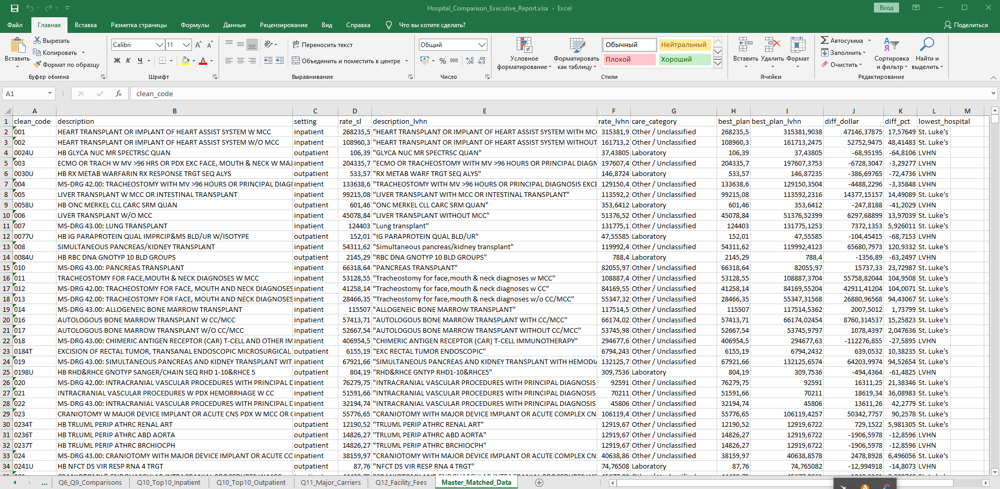

# US Hospital Price Transparency DuckDB Analytics


High-speed **Python + DuckDB + Pandas** analytics pipeline comparing **3M+ US hospital pricing records** (`CPT`, `MS-DRG`, `HCPCS`, `Revenue Codes`) across major insurance carriers with multi-sheet executive Excel reporting.



---

## Project Overview

This repository contains an end-to-end data analytics and ETL pipeline designed to ingest, normalize, and analyze CMS-mandated hospital price transparency datasets from Trilliant Oria (comparing **St. Luke’s Hospital - Bethlehem** and **Lehigh Valley Hospital - Cedar Crest / LVHN**).

The pipeline queries **3.0M+ insurance rate rows** in seconds using in-process DuckDB SQL joins, standardizes cross-hospital billing codes into **4,350 matched medical procedures**, maps codes into clinical service lines, and generates a 10-tab executive Excel workbook.

---

## Key Features & Methodology

1. **High-Performance OLAP Processing:** Uses **DuckDB** for fast, memory-efficient SQL queries over millions of pricing records without loading raw tables into RAM.
2. **Cross-Hospital Code Normalization:** Extracts and standardizes billing codes (`CPT`, `HCPCS`, `MS-DRG`, `RC`) to clean 5-character base codes (stripping modifier suffixes like `UE`, `KU`, `TC`, `26`) for fair comparisons.
3. **Automated Clinical Categorization (`step1_build_lookup.py`):** Maps **18,725+ unique billing codes** into standardized service lines (`Emergency Room`, `Clinic Visits`, `Orthopedics`, `Cardiology`, `Imaging / Radiology`, `Laboratory`, `Maternity`, `Surgery`).
4. **Executive Excel Reporting (`step2_run_full_report.py`):** Ranks insurance plans (`Aetna`, `BCBS`, `Highmark`, `Cigna`, `Medicare`), evaluates carrier availability (`Both` vs. single-system), compares negotiated vs. cash rates, and exports a 10-sheet workbook.

---

## Repository Structure

```text
├── step1_build_lookup.py                 # Extracts unique billing codes & builds clinical care-category lookup
├── step2_run_full_report.py              # Runs DuckDB analytics, cross-hospital matching & 10-tab Excel export
├── requirements.txt                      # Python dependencies (duckdb, pandas, numpy, openpyxl)
├── docs/
│   └── hospital_pricing_excel_report.png # Sample multi-sheet executive Excel report output
└── README.md                             # Project documentation
```

---

## Tech Stack

- **Language:** Python 3.8+
- **Database & OLAP Engine:** DuckDB
- **Data Transformation & Analysis:** Pandas, NumPy
- **Report Generation:** OpenPyXL

---

## Executive Excel Output (`Hospital_Comparison_Executive_Report.xlsx`)

The generated workbook includes dedicated tabs covering:

- **Q2_Q4_Overview:** Dataset freshness dates, total rate records, and matched procedure counts.
- **Q1_Carriers_List:** Insurance carriers, plan names, plan types, and cross-system availability.
- **Q5_Plans_StLukes / Q5_Plans_LVHN:** Major insurance plans ranked by procedure coverage and competitiveness.
- **Q6_Q9_Comparisons:** Side-by-side hospital cost comparisons broken down by clinical care category.
- **Q10_Top10_Inpatient / Q10_Top10_Outpatient:** High-cost procedure benchmarks with lowest-cost option flags.
- **Q11_Major_Carriers:** Cross-carrier cost comparison between both health systems.
- **Q12_Facility_Fees:** Emergency room (`99281–99285`) and clinic visit (`99202–99215`) level pricing.

---

## Data Sources

This pipeline uses publicly available CMS Hospital Price Transparency datasets parsed into DuckDB by Trilliant Health (Oria):

- **St. Luke's Hospital – Bethlehem Campus (`51.5 MB`, `1.29M` rate rows):** [Download & Schema Details](https://oria-data.trillianthealth.com/hospital/st_lukes_hospital_bethlehem_campus-c43ea)
- **Lehigh Valley Hospital – Cedar Crest / LVHN (`129.0 MB`, `1.70M` rate rows):** [Download & Schema Details](https://oria-data.trillianthealth.com/hospital/lehigh_valley_hospital_cedar_crest-9591f)
- **Trilliant Oria DuckDB Documentation:** [Data Dictionary & Schema Guide](https://oria-data.trillianthealth.com/docs#consolidated-download)

---

## Quick Start

1. **Clone the repository:**
   ```bash
   git clone https://github.com
   cd US-Hospital-Price-Transparency-DuckDB-Analytics
   ```

2. **Install dependencies:**
   ```bash
   pip install -r requirements.txt
   ```

3. **Place both `.duckdb` files in the project root** (`st_lukes_hospital_bethlehem_campus-c43ea_parsed.duckdb` and `lehigh_valley_hospital_cedar_crest-9591f_parsed.duckdb`).

4. **Run the two-stage pipeline:**
   ```bash
   python step1_build_lookup.py
   python step2_run_full_report.py
   ```
